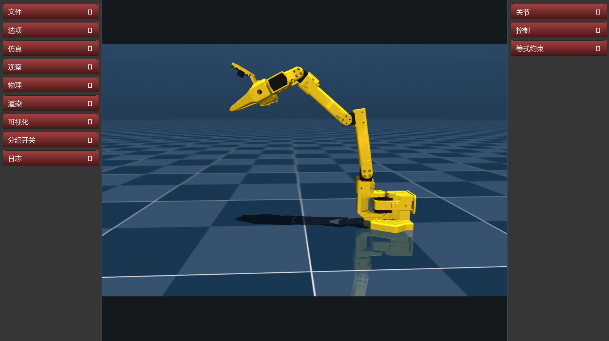

<div align="center">

[](https://github.com/google-deepmind/mujoco)
[](https://www.python.org/)
[](https://www.microsoft.com/windows)
[](LICENSE)
[](https://github.com/ywsldxk/mujoco-cn)
[](https://huggingface.co/ywsldxk1/mujoco-cn)

# mujoco-cn

**A Chinese-language desktop manipulation simulator for MuJoCo**

SO-101 keyboard teleoperation · Multi-object OBJ / STL / MJCF import · Extensible scenes



[简体中文](README.md) · [English](README.en.md)

</div>

---

## Features

- Chinese collapsible side menus with an unobstructed central scene view.
- Keyboard teleoperation for SO-101 using W/S, A/D, I/K, J/L, Ctrl, and gripper keys.
- Import multiple OBJ, STL, or standalone MJCF XML objects from the File menu.
- Inspect joint angles, use joint sliders, and toggle geometry groups and contact visualization.
- Uses The Robot Studio SO101 model from the official MuJoCo Menagerie package for the default demo.

## Quick start on Windows

Requires Python 3.11 or newer. Run in PowerShell:

```powershell
.\scripts\setup.ps1
.\scripts\run.ps1
```

The virtual environment and Menagerie model cache live inside the project directory.

## Importing objects

Open **File → Import objects**, then select one or more files:

- **OBJ / STL** files are wrapped as movable objects. Choose the mesh-to-meter scale when importing; use `0.001` for millimeter assets and `1` for meter assets. Mesh collision uses a convex hull, so complex concave objects should use MJCF with simplified collision geometry.
- **MJCF XML** files should describe standalone objects, not complete environments containing floors and lights.

The scene is recompiled after import while preserving the robot and demo bottle poses. Imported objects are placed in front of the arm. Format adapters live in [`object_import.py`](object_import.py).

## Licensing

The project code is licensed under Apache-2.0. MuJoCo and Menagerie's `robotstudio_so101` model are also Apache-2.0. The model is downloaded at runtime and is not redistributed in this repository. See [NOTICE](NOTICE) for third-party attribution.

mujoco-cn is an independent community project, not an official Google DeepMind product.
